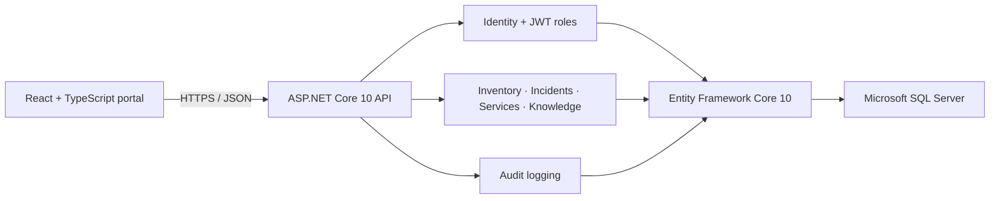

# OpsFlow

OpsFlow is an internal operations control center that connects IT inventory, production incident response, service ownership, reusable knowledge, and audit history. It answers three practical questions in one place:

1. What equipment and software services do we operate?
2. What production problems are affecting them now?
3. How did we solve similar problems before?

The repository is intentionally built as a modular monolith: a React/TypeScript interface, an ASP.NET Core 10 API, Entity Framework Core 10, SQL Server, JWT authentication, and role-based authorization.

## Demo accounts

All seeded accounts use the password `Demo123!`.

| Role | Email | What to explore |
|---|---|---|
| Administrator | `admin@opsflow.demo` | Audit history, service administration, all workflows |
| Support Engineer | `support@opsflow.demo` | Incidents, timelines, resolution, knowledge articles |
| Inventory Manager | `inventory@opsflow.demo` | Assets, stock movements, assignments, transfers |
| Viewer | `viewer@opsflow.demo` | Read-only dashboards, records, and published articles |

The hosted UI is an interactive recruiter demo. Its changes are intentionally ephemeral; the Docker stack uses the authenticated SQL Server API for durable operational records.

## Core features

- Asset lifecycle management with archive-not-delete behavior
- Check-in, check-out, transfer, adjustment, and retirement history
- Low-stock and expiring-warranty alerts
- Incident severity, priority, assignment, status, comments, and resolution
- Linked assets, applications, services, and dependencies
- Resolved-incident to knowledge-article workflow
- Searchable articles, publication states, tags, review reminders, and feedback
- Operational dashboard with meaningful incident and inventory signals
- Append-only audit history for important changes
- Seeded role-based demo access
- Pagination, filtering, sorting, validation, Problem Details, health checks, and structured logs

## Architecture



The backend separates domain rules, application contracts, persistence, and HTTP endpoints without adding microservice deployment overhead. See [docs/architecture.md](docs/architecture.md) and [docs/database-design.md](docs/database-design.md).

## Technology stack

- Frontend: React 19, TypeScript, Vite/Vinext, Lucide icons
- Backend: C#, ASP.NET Core 10 minimal APIs
- Persistence: EF Core 10, SQL Server, committed migration
- Authentication: ASP.NET Core Identity, signed JWT bearer tokens
- API documentation: Swagger/OpenAPI
- Logging: Serilog structured console logs
- Testing: xUnit, FluentAssertions, Moq, ASP.NET integration testing
- Infrastructure: Docker, Docker Compose, GitHub Actions, Dependabot

## Run locally

Prerequisites: Docker Desktop with at least 4 GB available memory on an x86-64 host. Microsoft supports SQL Server Linux containers only on Intel/AMD x86-64 Linux; on Apple Silicon, point the API connection string at a remote SQL Server instance instead of starting the bundled database service.

```bash
cp .env.example .env
docker compose up --build
```

Then open:

- Portal: [http://localhost:3000](http://localhost:3000)
- API documentation: [http://localhost:8080/swagger](http://localhost:8080/swagger)
- Health check: [http://localhost:8080/health](http://localhost:8080/health)

The API applies the committed migration and seeds accounts, assets, services, incidents, knowledge articles, and audit history on first start.

Stop the stack with `docker compose down`. Add `-v` only when you intentionally want to remove the local SQL Server volume and its data.

## Developer workflow

Frontend:

```bash
npm install
npm run dev
npm test
npm run lint
```

Backend (with a .NET 10 SDK):

```bash
dotnet restore server/OpsFlow.slnx
dotnet build server/OpsFlow.slnx --configuration Release
dotnet test server/OpsFlow.slnx --configuration Release
```

The test suite currently covers 49 domain-rule cases and 8 authenticated API workflows.

## API surface

| Area | Representative endpoints |
|---|---|
| Authentication | `POST /api/auth/login`, `POST /api/auth/register`, `GET /api/users/me` |
| Assets | `GET/POST /api/assets`, `POST /api/assets/{id}/transactions`, `transfer`, `archive` |
| Incidents | `GET/POST /api/incidents`, `assign`, `comments`, `resolve` |
| Services | `GET/POST/PUT /api/services` |
| Knowledge | `GET/POST /api/articles`, `from-incident`, `publish`, `feedback` |
| Operations | `GET /api/dashboard/summary`, `GET /api/audit-logs`, `GET /health` |

Swagger documents the complete request and response models when the API is running.

## Repository structure

```text
app/                         React portal
server/
  OpsFlow.Domain/            Entities and operational enums
  OpsFlow.Application/       API contracts, roles, business rules
  OpsFlow.Infrastructure/    Identity, EF Core, migrations, seed data, auditing
  OpsFlow.Api/               HTTP pipeline, JWT, Swagger, endpoints
  OpsFlow.UnitTests/         Domain-rule tests
  OpsFlow.IntegrationTests/  Authenticated workflow tests
docs/                        Architecture, database, support, and deployment guides
.github/                     CI, Dependabot, issue and pull-request templates
```

## Connected demo story

1. Sign in as the inventory manager and add replacement laptops.
2. Review the low-stock and warranty alerts in the asset registry.
3. Sign in as the support engineer and open the critical Employee Portal incident.
4. Follow the chronological investigation updates and linked server.
5. Move the incident through monitoring and resolution.
6. Convert the resolution into a reusable knowledge article.
7. Return to the dashboard and inspect the complete audit trail as an administrator.

## Engineering decisions

- Operational records are archived, not permanently deleted.
- Authorization is enforced on the API, not trusted to the interface.
- Incident state transitions and publication requirements are explicit domain rules.
- Inventory transactions are atomic and preserve quantity/location history.
- Seeded data tells one connected operational story rather than presenting random CRUD records.
- The API returns RFC 9457-style Problem Details with trace IDs for failures.

## Production considerations

- **Authentication:** Rotate the JWT signing key, use a managed secret store, shorten token lifetime, and add refresh-token revocation or enterprise SSO.
- **Authorization:** Keep role checks server-side; add resource-level policies if office or department boundaries are introduced.
- **Logging:** Ship Serilog JSON events to a centralized sink and exclude credentials, tokens, and sensitive notes.
- **Error handling:** Preserve trace IDs for support while keeping internal exception details out of production responses.
- **Database backups:** Enable automated full/differential/log backups and run restoration drills with documented RPO/RTO targets.
- **Secrets management:** Store SQL and JWT credentials in the deployment platform; never commit real secrets.
- **Health monitoring:** Monitor `/health`, request latency, error rate, SQL connectivity, queue age, and certificate expiration.
- **Scalability:** Keep API instances stateless, paginate large tables, add database indexes from measured query plans, and use background jobs for reminders.
- **Auditability:** Restrict audit-log access, preserve retention controls, and forward high-value events to an immutable security archive.

## Known limitations

- The hosted recruiter interface uses seeded ephemeral demo state; durable writes live in the Docker/API stack.
- Email notifications, attachments, real-time SignalR updates, and enterprise identity are intentionally deferred.
- The local SQL Server container runs in Developer edition and is not a production database topology.

## Future improvements

SignalR incident updates, background SLA/review reminders, CSV import/export, attachments, Microsoft Entra ID, OpenTelemetry traces, and deployment-provider workflows are natural next steps after the core product is deployed.

## License

[MIT](LICENSE)
