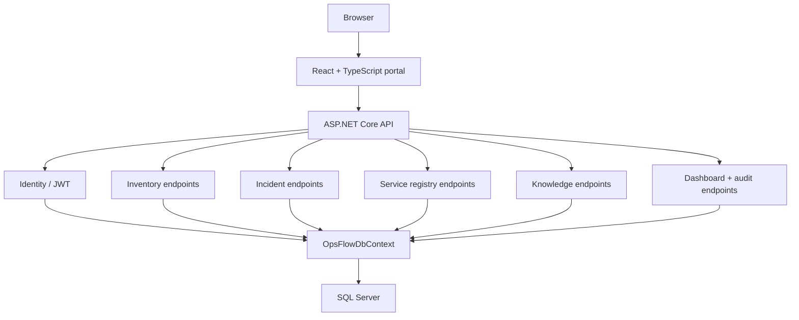

# Architecture

## Decision

OpsFlow uses a modular monolith. The inventory, incident, service-registry, knowledge, identity, reporting, and audit capabilities share one deployment and one relational database while keeping explicit code boundaries.

This shape gives the project transactional consistency, straightforward debugging, and a small operational footprint. It also leaves room to extract a module later if real scale or ownership boundaries justify the cost.

## Runtime view

## Backend boundaries

- `OpsFlow.Domain` owns entities and enums. It has no infrastructure dependency.
- `OpsFlow.Application` owns roles, request contracts, pagination, and business rules.
- `OpsFlow.Infrastructure` owns EF Core, Identity stores, seed data, migrations, and audit persistence.
- `OpsFlow.Api` owns HTTP, authentication, authorization policies, Swagger, CORS, error handling, and endpoint composition.

Dependencies point inward: API → Infrastructure/Application → Domain.

## Security model

JWT tokens identify a user and carry role claims. API policies protect every write path:

| Policy | Roles |
|---|---|
| InventoryWrite | Administrator, Inventory Manager |
| SupportWrite | Administrator, Support Engineer |
| KnowledgeWrite | Administrator, Support Engineer |
| AdminOnly | Administrator |

Viewer access is read-only. UI affordances improve the experience, but API policies are authoritative.

## Transaction and audit model

Asset quantity/location changes and their inventory transactions commit together. Incident status history is append-only. Important writes add an audit row in the same unit of work as the changed entity, preserving user, action, entity, timestamp, and before/after values when useful.

## Error and observability model

Unhandled errors pass through a single Problem Details handler and receive a trace ID. Serilog captures structured request logs. `/health` verifies SQL connectivity so deployment health checks fail when the application cannot serve operational data.
