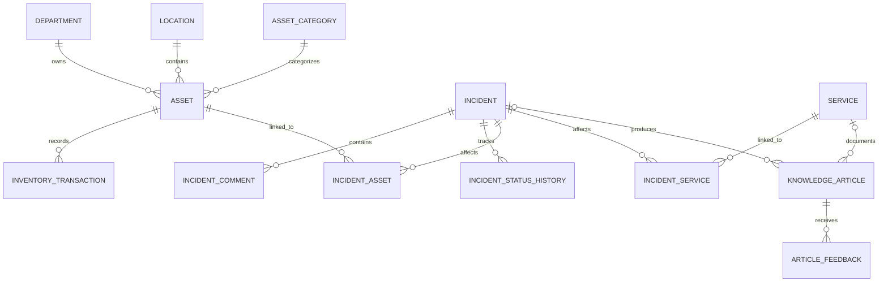

# Database design

## Entity relationships

ASP.NET Core Identity contributes users, roles, user roles, claims, logins, and tokens.

## Integrity choices

- Asset tags, incident numbers, article numbers, service names, department names, location names, and category names are unique.
- Organization records use restricted deletes while operational records point to them.
- Incident-to-asset and incident-to-service links use composite primary keys.
- Incident and service references on knowledge articles become null rather than deleting the article.
- Operational entities carry created/updated metadata and an archive flag.
- Audit logs are append-only application records.

## Lifecycle behavior

Assets and incidents are archived rather than deleted. Inventory transactions, incident comments, and status history remain attached so a later investigation can reconstruct what happened.

## Migration

`InitialCreate` under `OpsFlow.Infrastructure/Persistence/Migrations` creates the full schema, including Identity tables and operational indexes. The API applies pending migrations before seeding demo data.
