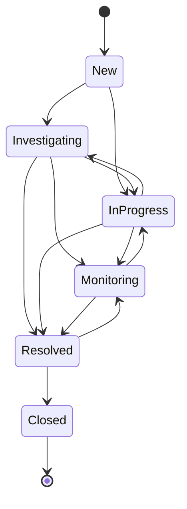

# Production support workflow

## Incident lifecycle

Every status change creates status history and audit context. Resolution requires an actionable summary of at least 20 characters. Only resolved or closed incidents can be converted into knowledge drafts.

## Severity targets

| Severity | Meaning | Target resolution |
|---|---|---|
| SEV-1 | Critical system outage | 4 hours |
| SEV-2 | Major functionality unavailable | 8 hours |
| SEV-3 | Limited functionality affected | 2 days |
| SEV-4 | Minor issue or request | 5 days |

The targets create `DueAt` timestamps and power overdue filtering. They are sample portfolio defaults, not contractual SLAs.

## Response checklist

1. State user/business impact in the title and description.
2. Set severity from impact, not implementation complexity.
3. Assign an incident commander or responsible engineer.
4. Link every affected service and known asset.
5. Add chronological, evidence-based internal updates.
6. Move to monitoring only after the corrective change is complete.
7. Resolve with a concise summary of cause, correction, and validation.
8. Convert reusable learning into a reviewed knowledge article.
9. Close only when follow-up ownership is clear.

## Audit expectations

Creation, assignment, severity/status changes, comments, resolution, article conversion/publication, and linked inventory changes should be attributable. Sensitive credentials and tokens must never be copied into comments or audit values.
